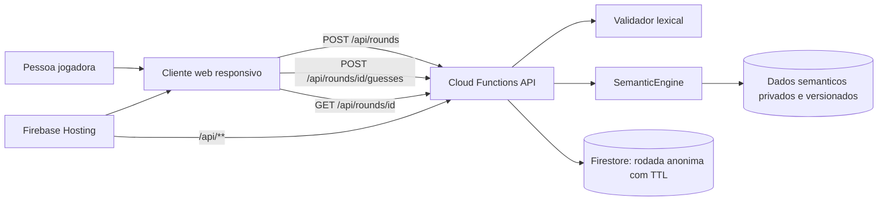
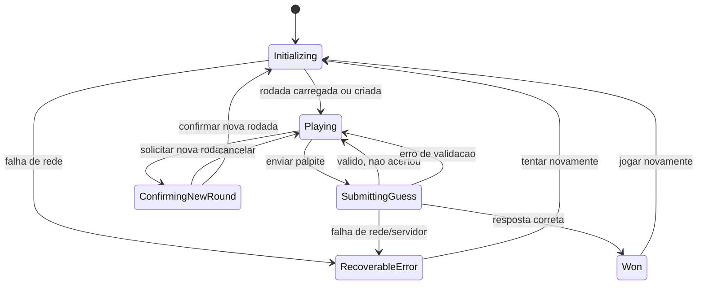

# Documento de design tecnico: jogo semantico de palavras

**Data:** 2026-10-13  
**Status:** proposta tecnica para revisao; depende de decisoes de produto em aberto no [PRD](../../PRD.md). A implementacao local do MVP foi iniciada; veja “Implementacao atual” abaixo.
**Design de referencia unico:** prototipo 1, “Caderno de campo”, adaptado para tons de roxo. Nenhuma outra direcao visual ou alternativa de interface faz parte desta especificacao.

## 1. Resumo

Este documento propoe como evoluir a demonstracao em `prototipos.html` para um jogo web funcional de partidas ilimitadas, individual e sem cadastro. A pessoa envia palavras em portugues brasileiro e recebe uma pista textual e visual de proximidade semantica. A resposta e descoberta, entao o calculo e a palavra-alvo devem permanecer no servidor.

A interface segue a composicao editorial e investigativa do prototipo 1: titulo serifado, controles simples, historico de palpites e uma trilha de proximidade. O roxo passa a ser a cor de identidade; o estado da pista tambem sera escrito em texto, nunca comunicado somente pela cor.

A tela de producao tera somente essa direcao: nao tera seletor de prototipos, mostrador circular de pontuacao, painel analitico numerico como linguagem visual primaria, nem mistura das identidades dos outros estudos. A escolha de como calcular proximidade continua sendo uma decisao de regra no PRD; esta restricao e visual.

Este documento separa a arquitetura recomendada para evolucao futura da implementacao local atual. A arquitetura Firebase abaixo continua sendo uma proposta; nao representa servicos ja configurados nem requisitos aprovados.

### Implementacao atual

- Cliente sem framework em `public/`, servido pelo servidor Node.js nativo em `server.js`.
- API same-origin para criar, consultar e atualizar rodadas. O alvo e o motor ficam no servidor; rodadas sao mantidas em memoria e se perdem quando o processo reinicia.
- `sessionStorage` guarda o identificador da rodada para retomada na mesma aba enquanto o servidor mantiver a rodada.
- `src/game-engine.js` usa um vocabulario curado e atributos de associacao para oferecer feedback deterministico por faixas. Esse conjunto e uma base demonstrativa limitada, nao um modelo semantico abrangente nem o corpus versionado recomendado abaixo.
- `tests/` cobre regras do motor e fluxos principais da API. Persistencia duravel, limite de requisicoes, curadoria/licenca de um vocabulario abrangente e validacao humana de qualidade semantica continuam pendentes.

Essa implementacao aplica a direcao visual “Caderno de campo” e entrega o fluxo jogavel local, sem afirmar que as decisoes abertas do PRD ou os requisitos operacionais da arquitetura proposta estejam aprovados.

## 2. Escopo e limites

### Incluido no MVP proposto

- Acesso pelo navegador, sem conta e sem fluxo de cadastro.
- Inicio de uma partida livre e possibilidade de iniciar outra partida imediatamente.
- Campo de texto para palpites em portugues brasileiro.
- Feedback semantico do servidor e historico de palpites da rodada.
- Encerramento quando a palavra correta for encontrada e revelacao da resposta.
- Contagem de tentativas e cronometro exibido como informacao da rodada.
- Experiencia desktop prioritaria, com layout adaptavel para telas estreitas.
- Interface acessivel por teclado, com leitores de tela e sem dependencia exclusiva de cor.

### Fora do MVP

- Duelo, ranking, placar social e sincronizacao entre pessoas.
- Desafio diario como modo obrigatorio.
- Contas, perfis, autenticacao e estatisticas sincronizadas entre dispositivos.
- Definicoes, exemplos de uso, etimologia, categorias editoriais ou recursos didaticos.
- Sistema de niveis, monetizacao, publicidade ou notificacoes.

### Nao usar como regra de produto

Os valores iniciais (`Mar`, `Folha`, `Flor`), a pontuacao artificial, os limiares “Frio/Morno/Quente”, a palavra de resposta e o acrescimo fixo de segundos em `prototipos.html` existem somente para demonstrar interacoes. Nao devem ser reaproveitados como algoritmo ou regra real.

## 3. Decisoes de produto ainda necessarias

Antes de implementar a experiencia final, revisar e aprovar no PRD:

1. Se proximidade sera apresentada por faixa textual, posicao/ranking, numero, ou combinacao. O prototipo 1 favorece faixas textuais.
2. Se a rodada termina somente ao acertar ou se existira limite de palpites, desistencia ou dica.
3. Se o tempo e somente informativo ou participa do resultado. Esta proposta o trata como cronometro informativo; tentativas sao a medida principal.
4. Quais palavras sao respostas e quais sao palpites validos: flexoes, nomes proprios, estrangeirismos, regionalismos, termos ofensivos e palavras raras.
5. O que acontece ao iniciar outra rodada antes de concluir a atual.
6. Se a rodada atual e recordes locais sobrevivem a fechar/reabrir o navegador.
7. Se compartilhamento de resultado entra no MVP.
8. Se celular e tablet tambem sao dispositivos oficialmente suportados na primeira versao.

As escolhas tecnicas abaixo adotam defaults reversiveis onde possivel e identificam explicitamente os pontos que dependem dessas respostas.

## 4. Arquitetura proposta

### 4.1 Componentes

- **Cliente web:** TypeScript, HTML semantico e CSS modular; Vite para desenvolvimento e build estatico. Separar estado, renderizacao e adaptadores de API em modulos pequenos. A estrutura atual do prototipo e vanilla HTML/CSS/JS, portanto a introducao de TypeScript/Vite e uma proposta para organizar a aplicacao, nao uma dependencia ja presente.
- **Hospedagem:** Firebase Hosting para os arquivos estaticos e roteamento `/api/**` para a funcao de backend. Essa escolha e alinhada ao fluxo de deploy do codelab de referencia; pode ser trocada sem alterar o dominio do jogo.
- **API:** Cloud Functions for Firebase (2nd gen), Node.js LTS. Mantem validacao, selecao da palavra, dicionario e calculo semantico fora do cliente.
- **Persistencia de rodada:** Firestore com documentos anonimos de rodada e politica TTL. A rodada nao requer conta; seu identificador de alta entropia funciona como credencial temporaria para retomar aquela partida. Aplicar TTL curto, por exemplo 24 horas, apos validar o requisito de retomada.
- **Dados lexicais e semanticos:** artefatos de dados versionados, carregados no servidor, nunca enviados junto ao bundle do cliente. O formato e a origem/licenca dos dados devem ser aprovados antes de distribuir o jogo.

Nenhum dado pessoal e necessario para a mecanica. O identificador anonimo da rodada nao e um perfil e nao deve ser usado para rastrear pessoas entre partidas.

### 4.2 Diagrama de componentes



### 4.3 Estrutura de diretorios sugerida

```text
src/
  app/
    main.ts
    router.ts
  game/
    game-controller.ts
    game-state.ts
    game-rules.ts
    game-api.ts
    normalize-word.ts
    render-feedback.ts
  components/
    game-header.ts
    guess-form.ts
    guess-history.ts
    proximity-feedback.ts
    game-result.ts
  styles/
    tokens.css
    base.css
    game.css
    accessibility.css
functions/
  src/
    index.ts
    routes/rounds.ts
    services/round-service.ts
    services/semantic-engine.ts
    services/lexicon.ts
    repositories/round-repository.ts
    schemas/requests.ts
  data/
    lexicon/
    semantic/
tests/
  unit/
  integration/
  e2e/
docs/
  plans/
```

O MVP pode permanecer numa unica tela e nao precisa de um roteador completo. Os diretorios sao limites de responsabilidade, nao uma exigencia de criar um componente por elemento visual.

## 5. Modelo de dominio e regras

### 5.1 Entidades

**Round**

- `id`: identificador aleatorio, nao sequencial e dificil de adivinhar.
- `status`: `playing` ou `won`.
- `targetId`: referencia privada a palavra-alvo.
- `createdAt`, `updatedAt`, `finishedAt`: timestamps UTC do servidor.
- `guesses`: lista ordenada de palpites aceitos e respectivas faixas/pontuacoes devolvidas.
- `lexiconVersion`, `semanticVersion`: versoes usadas naquela rodada, para resultados reproduziveis.
- `expiresAt`: instante para remocao por TTL.

**Guess**

- `normalizedWord`: forma canonica usada na validacao e comparacao.
- `displayWord`: forma enviada para exibir no historico, apos validacao e escaping normal.
- `submittedAt`: timestamp do servidor.
- `proximity`: valor interno retornado pelo motor ou uma classificacao derivada dele.

O servidor e autoritativo para status, alvo, validade e pontuacao. O cliente mantem apenas uma projecao para renderizar a tela.

### 5.2 Normalizacao e validacao

Proposta inicial para validar com o PRD:

1. Remover espacos externos, aplicar Unicode NFD, retirar marcas diacriticas e converter para minusculas com locale `pt-BR`. Assim, uma tentativa com ou sem acento compara na mesma forma canonica.
2. Aceitar somente letras, incluindo letras portuguesas; rejeitar numeros, emoji, pontuacao isolada e entrada vazia.
3. Consultar o lexicon no servidor antes de calcular proximidade.
4. Detectar palpites repetidos na mesma rodada pela forma canonica.
5. Responder com erro especifico para entrada invalida, palavra desconhecida, repeticao ou rodada encerrada.

As regras de letras compostas, hifenizacao, palavras com apostrofo, flexoes e variantes devem ser determinadas junto com a curadoria do lexicon. A normalizacao nao pode remover caracteres silenciosamente de forma que duas palavras distintas passem a ser equivalentes sem uma decisao editorial.

### 5.3 Motor semantico

Definir a interface antes de escolher um corpus/modelo:

```ts
type ProximityResult = {
  score: number;
  band: "cold" | "warm" | "hot" | "exact";
  semanticVersion: string;
};

interface SemanticEngine {
  compare(guess: string, targetId: string): Promise<ProximityResult>;
}
```

Direcao tecnica recomendada: gerar e avaliar os dados semanticos offline a partir de um modelo/corpus em portugues brasileiro, e consultar uma versao congelada no servidor. Nao executar um modelo generativo por palpite: a resposta precisa ser deterministica, barata, explicavel em testes e sem depender da disponibilidade de um provedor de IA.

Antes de aprovar o artefato, montar um conjunto de avaliacao com palavras-alvo e palpites revisados por falantes de portugues brasileiro. Medir se sinonimos, associacoes comuns, sinonimos contextuais, homonimos, antonimos e palavras polissêmicas aparecem em posicoes intuitivas. Examinar especialmente casos em que embeddings por coocorrencia aproximam palavras que nao sao sinonimas. A faixa apresentada nao deve alegar uma precisao maior do que os dados suportam.

Se o resultado visivel for ranking, calcular sua referencia sobre um vocabulario fixo e versionado. Se for escore continuo, documentar normalizacao e limiares das faixas. Esses detalhes ficam bloqueados ate a decisao de produto sobre o feedback.

## 6. Contratos da API

Todos os endpoints sao same-origin sob `/api`. Respostas JSON, UTF-8; erros seguem `{ "error": { "code": "...", "message": "..." } }`. Nao retornar alvo, vetor, vizinhanca completa ou resposta correta antes do acerto/encerramento.

### Criar rodada

`POST /api/rounds`

Resposta `201`:

```json
{
  "roundId": "opaque-random-id",
  "status": "playing",
  "createdAt": "2026-10-13T12:00:00Z",
  "guessCount": 0,
  "proximity": null
}
```

O servidor escolhe o alvo e grava a rodada sem expor o alvo. Aplicar limite contra automacao abusiva sem impedir partidas ilimitadas de uma pessoa normal.

### Consultar/retomar rodada

`GET /api/rounds/{roundId}`

Devolve estado, palpites e progresso sem revelar o alvo se `status` for `playing`. Rodadas expiradas retornam `404 ROUND_EXPIRED`; rodadas vencidas podem ser consultadas ate o TTL, incluindo a resposta.

### Enviar palpite

`POST /api/rounds/{roundId}/guesses`

```json
{ "word": "flor" }
```

Resposta `200` aceita:

```json
{
  "guess": { "word": "flor", "index": 1 },
  "feedback": { "band": "warm", "label": "Morno", "score": 0.72 },
  "round": { "status": "playing", "guessCount": 1 }
}
```

Resposta de acerto inclui `status: "won"`, `answer` e timestamps de conclusao. `score` so deve ser enviado ao cliente se a interface escolhida realmente usa valor numerico. Usar HTTP `400` para formato malformado, `404` para palavra nao aceita/rodada inexistente, `409` para palpite duplicado ou rodada concluida, `429` para limite de requisicoes e `5xx` para falha recuperavel.

Os valores do exemplo sao ilustrativos, nao regras aprovadas.

## 7. Eventos e fluxo de estado



O estado `ConfirmingNewRound` so e necessario se o PRD decidir confirmar a perda da rodada atual. Se rodadas incompletas puderem ser abandonadas sem aviso, remover esse estado.

### Transicao de envio

1. Submeter o formulario por `Enter` ou botao; bloquear envio duplicado enquanto `SubmittingGuess`.
2. Validar vazio, formato e repeticao localmente para resposta imediata, sem tratar isso como validacao de seguranca.
3. Enviar ao servidor; preservar texto e foco se houver erro recuperavel.
4. Em aceite, adicionar a resposta do servidor ao historico em ordem de envio, atualizar contador e feedback. Historico deve continuar legivel apos varios palpites, com o mais recente em posicao previsivel.
5. Em acerto, alterar para `Won`, apresentar resposta, total de tentativas e tempo, bloquear o formulario e oferecer “Jogar novamente”.

## 8. Persistencia e privacidade

- **Servidor:** manter apenas estado temporario das rodadas anonimas no Firestore; habilitar TTL e definir retencao aprovada. Nao guardar IP, nome ou identificador persistente como parte do dominio do jogo. Logs operacionais devem evitar incluir palpites ou ids de rodada em texto livre quando nao forem necessarios.
- **Cliente:** guardar o `roundId` da rodada ativa em `sessionStorage` por padrao. Ao reabrir a mesma aba, consultar a API para retomar; se indisponivel/expirada, oferecer nova rodada. Se o PRD pedir retomada apos fechar navegador, mudar para `localStorage` e documentar que o id e uma credencial temporaria.
- **Estatisticas:** nao persistir recordes ate haver requisito aprovado. Se adicionados sem conta, mantelos localmente e explicar que sao especificos daquele navegador/dispositivo.
- **Seguranca:** HTTPS, validacao de payload e tamanho, ids imprevisiveis, limite de requisicoes, App Check quando compativel com hospedagem e Firebase Security Rules sem acesso direto do cliente aos documentos de rodada. Toda leitura/escrita da rodada deve passar pela API.

## 9. Interface e sistema visual

### Direcao do prototipo 1

Implementar exclusivamente o conceito “Caderno de campo”: composicao editorial serena, titulo serifado, rotulos concisos, historico claro e feedback como observacao de proximidade. Aplicar roxo como identidade, preservando diferenciais de estado por texto, forma e posicao. Nao oferecer alternancia para outros conceitos e nao transportar os elementos caracteristicos das outras direcoes do arquivo de prototipos.

Composicao aprovada para orientar a implementacao:

- Cabecalho compacto com marca e acao de nova rodada.
- Area principal com estado, titulo, instrucao, uma unica representacao de proximidade, campo de palpite e mensagem acessivel.
- Historico em coluna lateral no desktop e abaixo da area principal em telas estreitas.
- Tipografia editorial: serifada para titulos, sans-serif para texto e mono apenas para metadados curtos.
- Paleta roxa clara: fundos lilas quase brancos, texto ameixa escuro, roxo para acao/identidade e tom quente auxiliar para indicar temperatura, sempre acompanhado de texto.
- Sem graficos de ranking, placares competitivos ou seletor de temas no MVP.

Tokens iniciais propostos, a validar em teste de contraste:

```css
:root {
  color-scheme: light;
  --color-page: #f8f5fb;
  --color-surface: #fffdfd;
  --color-ink: #281d31;
  --color-muted: #62596b;
  --color-line: #ded5e7;
  --color-primary: #603b82;
  --color-primary-hover: #4c2d69;
  --color-primary-soft: #ece4f3;
  --color-feedback-warm: #a64732;
  --color-feedback-soft: #f5e8e4;
}
```

Usar Fraunces para titulos e DM Sans para corpo; DM Mono apenas para metadados e numeros curtos. Hospedar as fontes localmente depois de verificar licencas, ou fornecer fontes alternativas sem quebrar layout. O roxo domina a identidade; um tom terroso de contraste pode sinalizar calor sem ser a unica indicacao.

### Hierarquia de tela

1. Cabecalho compacto: marca, modo de partida e acao “Nova rodada”.
2. Area de jogo: estado da rodada, titulo/instrucao, painel da pista, formulario de palpite e mensagem de validacao.
3. Historico: tentativas em ordem de envio, faixa textual e metadados de rodada.
4. Estado final: resposta, tentativas, tempo e acao para reiniciar.

No desktop, duas colunas como no prototipo: jogo principal e historico. Em largura estreita, empilhar jogo e historico, manter o formulario facil de usar e impedir scroll horizontal. Variantes de feedback ocultas no prototipo nao devem coexistir na interface de producao: entregar somente o modelo aprovado no PRD.

### Acessibilidade

- Formulario nativo com `label`, envio por `Enter`, foco visivel e mensagens de erro associadas via `aria-describedby`.
- Mensagens dinamicas por `aria-live="polite"`; nao anunciar continuamente o cronometro.
- Cada feedback comunica faixa por texto (“Frio”, “Morno”, “Quente”) e indicador visual. Nao usar cor como unico canal.
- Contraste de texto e controles auditado contra WCAG 2.2 AA. As cores listadas sao tokens iniciais e nao substituem medicao de contraste.
- Controles de toque com alvo de pelo menos 24 x 24 CSS px (WCAG 2.2 AA) e preferencialmente maiores nas acoes principais.
- Respeitar `prefers-reduced-motion`; animacoes nunca sao necessarias para entender o estado.
- Testar ampliacao, navegacao por teclado, leitor de tela, alto contraste do sistema e daltonismo. Definir opcao de alto contraste/modo daltonico apos fechar o escopo no PRD.

## 10. Estados de interface e falhas

- **Carregando:** indicar que a rodada esta sendo preparada; nao mostrar alvo ou resultado provisório enganoso.
- **Falha de rede ao criar rodada:** mensagem recuperavel com acao para tentar novamente; nao criar repetidas rodadas automaticamente.
- **Palpite invalido:** explicar se esta vazio, ja foi usado, contem caracteres proibidos ou nao consta no vocabulario aceito.
- **Envio em andamento:** impedir duplo clique, mas manter formulario utilizavel com estado acessivel.
- **Falha ao submeter:** preservar texto digitado e permitir repetir; requisicoes devem incluir um idempotency key para que retry nao duplique tentativa aceita.
- **Sessao expirada:** explicar que a rodada antiga nao pode ser retomada e iniciar outra somente apos acao da pessoa.
- **Acerto:** revelar a palavra, congelar o tempo e desabilitar novos palpites.
- **Abandono:** regra e dialog de confirmacao dependem do PRD.
- **Resposta de servidor indisponivel:** nao substituir feedback verdadeiro por simulacao local.

## 11. Testes e criterios de aceite tecnico

### Testes unitarios

- Normalizacao em portugues: caixa, acentos, espacos, cedilha, Unicode composto/decomposto e entradas nao alfabeticas.
- Validacao de lexicon, palpites repetidos, estados de rodada, vitoria e respostas apos fim.
- Motor semantico deterministico para exemplos versionados; casos de borda linguisticos aprovados por avaliador humano.
- Formatacao de duracao, contagem de tentativas e faixas de feedback.

### Testes de integracao

- Criar, consultar, retomar, palpitar, acertar e rejeitar palpite em rodada encerrada.
- Respostas e codigos HTTP para palavra desconhecida, repeticao, timeout, expiracao, limite de requisicoes e falha do motor.
- Verificar que a palavra-alvo e dados privados nao aparecem em respostas de rodada ativa, assets estaticos, source maps publicos ou logs do cliente.
- Verificar isolamento de duas rodadas anonimas concorrentes.

### Testes E2E e acessibilidade

- Fluxo completo no desktop e viewport estreita: iniciar, enviar palavra invalida, enviar palavra valida, conferir historico, acertar e iniciar outra rodada.
- Teclado sem mouse, ordem/foco, feedback de erro e anuncio do novo resultado com leitor de tela.
- Auditoria automatizada de acessibilidade mais revisao manual de contraste e interacao.
- `prefers-reduced-motion`, zoom do navegador e ausencia de overflow horizontal.

### Criterios para considerar implementado

- Todas as transicoes de estado especificadas funcionam sem depender da pontuacao demonstrativa do prototipo.
- Toda palavra e pontuacao visivel durante uma partida vem da API real.
- Resposta nao e exposta ate a condicao de vitoria ou encerramento definida no PRD.
- Recarregar a aba recupera ou informa corretamente o estado da rodada conforme a politica de persistencia escolhida.
- Nenhuma regra aberta neste documento e silenciosamente tratada como aprovada.

## 12. Deploy e operacao

1. Validacao local: lint, testes unitarios, testes da API e build do cliente.
2. Ambiente de preview Firebase separado da producao, com dataset sintetico e palavras-alvo conhecidas apenas em testes.
3. Pipeline de CI executa testes e build em cada alteracao; deploy preview por branch/PR e producao por aprovacao.
4. Configurar secrets do backend em Secret Manager; nunca incluir credenciais ou dataset privado em variaveis/client bundle publicos.
5. Ativar logs estruturados sem dados pessoais, metricas de erro/latencia e alertas de indisponibilidade.
6. Versionar lexicon e dados semanticos separadamente do codigo; permitir rollback para versao anterior caso a qualidade de proximidade piore.

Indicadores operacionais iniciais: disponibilidade da API, latencia p50/p95 de um palpite, taxa de erro por classe e falhas no carregamento da rodada. Metricas de engajamento devem ser definidas no PRD e nao coletar identificadores persistentes por padrao.

## 13. Riscos e mitigacoes

| Risco | Mitigacao proposta |
|---|---|
| Associacoes semanticas parecem arbitrarias em portugues | Avaliacao humana de pares palavra-alvo/palpite, versionamento e apresentacao em faixas compreensiveis |
| Palavra-alvo ou tabela de respostas e extraida do bundle | Dados semanticos e alvo somente no backend; testes de inspecao dos artefatos do cliente |
| Dicionario aceita palavras improvaveis ou rejeita variantes comuns | Politica editorial explicita, corpus licenciado e testes com falantes brasileiros |
| Partidas anonimas sao abusadas pela API | Rate limiting, payload restrito, ids imprevisiveis e monitoramento |
| Estado some ao fechar a pagina | Definir sessao vs persistencia no PRD e salvar somente o identificador temporario necessario |
| Cronometro penaliza interrupcoes ou assistive tech | Cronometro informativo por default; nao usa tempo como requisito de vitoria sem aprovacao |
| Tons roxos reduzem legibilidade ou ocultam faixa | Texto e forma junto da cor, validacao WCAG AA e opcao de alto contraste apos decisao de escopo |

## 14. Decisoes recomendadas para revisao

1. Aprovar como direcao o cliente TypeScript/Vite hospedado no Firebase Hosting e a API server-side em Cloud Functions.
2. Aprovar Firestore com TTL curto somente para estado temporario de rodada, ou solicitar uma alternativa sem persistencia de servidor.
3. Definir no PRD qual semantica de feedback a interface mostra antes de congelar o contrato da API.
4. Definir politica do lexicon, licenca/origem dos dados e criterios de palavras-alvo antes da curadoria final.
5. Confirmar se a rodada deve ser retomada apos fechar o navegador, se tempo e informativo e se abandonar uma rodada exige confirmacao.

## Referencias

- [PRD do jogo](../../PRD.md)
- [Prototipos navegaveis](../../prototipos.html)
- [Google Codelabs: escrever uma especificacao](https://codelabs.developers.google.com/codelabs/beyond-vibe-coding-for-the-web?hl=pt-br#4)
- [Firebase Hosting](https://firebase.google.com/docs/hosting)
- [Cloud Functions for Firebase](https://firebase.google.com/docs/functions)
- [Firestore TTL](https://firebase.google.com/docs/firestore/ttl)
- [WCAG 2.2: uso de cor](https://www.w3.org/WAI/WCAG22/Understanding/use-of-color.html)
- [WCAG 2.2: teclado](https://www.w3.org/WAI/WCAG22/Understanding/keyboard.html)
- [WCAG 2.2: tamanho minimo de alvo](https://www.w3.org/WAI/WCAG22/Understanding/target-size-minimum.html)